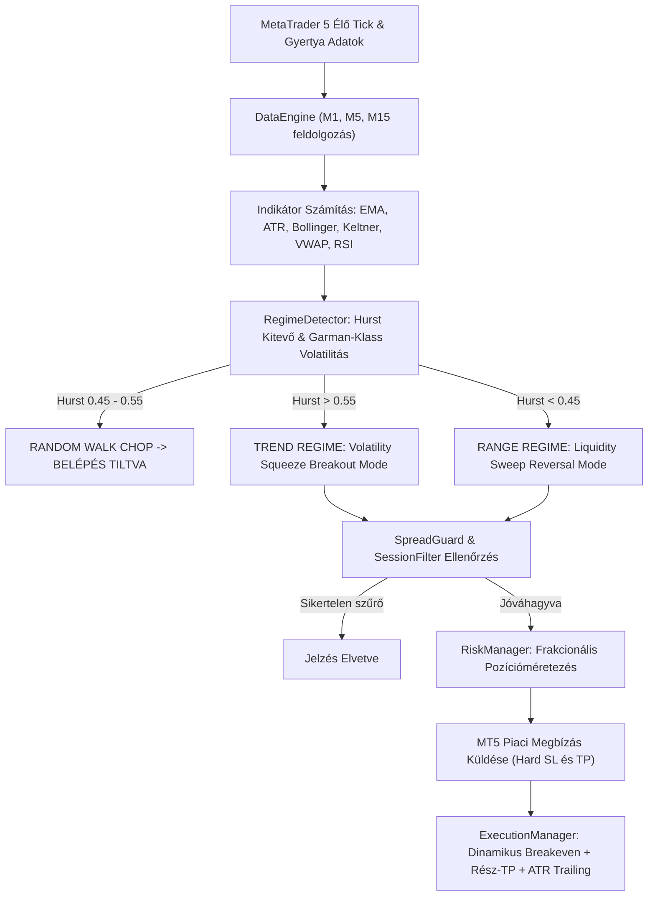

# 🏛️ TITAN QUANT SCALPER (Apex Micro-Regime MT5 Scalping System)

> **Professzionális, intézményi szintű kvantitatív scalpoló algoritmus MetaTrader 5 felületre, kis méretű tőkeállományra és CFD kereskedésre optimalizálva.**

---

## 📌 1. Vezetői Összefoglaló és Kvantitatív Filozófia

A legtöbb lakossági MetaTrader "robot" (EA) elbukik a valós piacokon. Ennek oka szinte mindig ugyanaz:
1. **Görbére illesztés (Overfitting):** Múltbeli adatokra túloptimalizált RSI/MACD szintek, amik azonnal elvéreznek, amint a piaci rezsim megváltozik.
2. **Katasztrofális pénzkezelés:** Martingale (veszteség duplázás) vagy Stop Loss nélküli rács (Grid) rendszerek, amelyek hónapokig egyenletesnek tűnnek, majd egyetlen híresemény alatt lenullázzák a számlát.
3. **A tranzakciós költségek (Friction) figyelmen kívül hagyása:** CFD scalpolásnál a spread, a jutalék (commission) és a végrehajtási csúszás (slippage) az első számú számlagyilkos. Ha egy bot 2 pip profitot céloz egy 1.2 pipes spread mellett, a bróker elviszi a bruttó nyereség 60%-át.

### A Titan Quant Scalper Megoldása:
A rendszer a modern kvantitatív pénzügyi kutatások (pl. Mandelbrot, Peters, John Carter és az intézményi HFT piacszerkezeti modellek) alapelveit egyesíti:
- **Több-idősíkos Rezsim-osztályozás (Hurst Exponent $H$):** Nem kereskedik a "véletlen bolyongás" (Random Walk / Chop, $0.45 \le H \le 0.55$) zónában, ami a piaci idő 60-70%-át kiteszi, és ahol a false kitörések keletkeznek.
- **Volatilitási Kompresszió és Kitörés (Squeeze Breakout):** Amikor a Bollinger-szalagok a Keltner-csatornán belülre préselődnek, a piac energiát halmoz fel. A kitörést a mikro-momentum irányában, intézményi VWAP és M15 trend-igazodással kereskedi le.
- **Mikro-strukturális Likviditási Sweep Fordulat (Mean Reversion):** Sávos piacon ($H < 0.45$) a swing csúcsok/mélypontok likviditási lesöprését (Stop Hunt) és elutasító gyertyaalakzatait vadássza le, visszatérve az egyensúlyi árhoz (VWAP).
- **Aszimmetrikus Ho-Ko Arány (Risk/Reward):** Sosem kockáztat többet a lehetséges nyereségnél. Dinamikus Breakeven (1.0R) és 50%-os részleges profitrealizálás (1.5R) biztosítja a tőkenövekedést.

---

## 📊 2. Kvantitatív Architektúra és Matematikai Modell



### A. Hurst Kitevő és Rezsim Detektálás ($H$)
A frakcionális Brown-mozgás diffúziós skálázódása alapján:
$$\mathbb{E}[(P_{t+\tau} - P_t)^2] \propto \tau^{2H} \implies \text{RMS}(\tau) \propto \tau^H$$
- $H > 0.55$: **Erős Irányultság (Persistent Trend)** $\implies$ Csak trendkövető kitörés engedélyezett.
- $H < 0.45$: **Visszatérő Dinamika (Anti-persistent / Mean-reverting)** $\implies$ Csak szélső sávos visszafordulás engedélyezett.
- $0.45 \le H \le 0.55$: **Zajos Bolyongás (Brownian Noise)** $\implies$ **SZIGORÚAN TILTOTT A BELÉPÉS.**

### B. Kis Tőkés Dinamikus Pozícióméretezés (Risk Parity / Fractional Risk)
A bot nem fix lotmérettel dolgozik, hanem a tőke pontosan beállított százalékát (alapértelmezett: $1.0\%$) kockáztatja minden egyes trade-en:
$$\text{Kockáztatott Összeg} = \text{Tőke (Equity)} \times \frac{\text{Kockázat}\%}{100}$$
$$\text{Lot Méret} = \frac{\text{Kockáztatott Összeg}}{\text{SL Távolság Pontban} \times \text{Tick Érték per Pont}}$$
A kapott érték automatikusan kerekítésre kerül a bróker minimális kötésegységére (`volume_step`, pl. 0.01 lot).

### C. Napi Vészfék Áramkörök (Circuit Breakers)
1. **Napi Maximális Visszaesés (Max Daily Drawdown):** Ha a számla aznapi vesztesége eléri a tőke $3.0\%$-át, a bot azonnal felfüggeszti a nyitásokat a következő nap kezdetéig.
2. **Veszteség-sorozat Hűtés (Cooldown):** Ha 3 egymást követő megbízás Stop Loss-t ér el, a bot azonnal 60 perces kényszerpihenőt rendel el a piaci megnyugvás kivárására.
3. **Rollover Védőablak (21:00 - 23:00 UTC):** Amikor a nemzetközi bankközi piacon a likviditás kiszárad és a spread 5-10x-re tágul, a rendszer tiltja az új kötések indítását.

---

## 🛠️ 3. Rendszerstruktúra

```
d:\Trading algo\
├── config/
│   ├── config.yaml           # Központi felhasználóbarát konfiguráció
│   ├── settings.py           # Konfiguráció betöltő és típusvalidáció
│   └── __init__.py
├── core/
│   ├── mt5_client.py         # Robusztus, szálbiztos MetaTrader 5 API réteg
│   ├── mock_client.py        # Szimulációs kliens (Offline Dry-run teszteléshez)
│   ├── data_engine.py        # Több-idősíkos (M1, M5, M15) OHLCV és indikátormotor
│   ├── regime_detector.py    # Hurst-kitevő és volatilitás-osztályozó
│   └── __init__.py
├── strategies/
│   ├── base_strategy.py      # Stratégia absztrakt interfész
│   ├── signals.py            # TradeSignal és SignalType adatmodellek
│   ├── titan_scalper.py      # Titan Quant Scalper stratégiamag
│   └── __init__.py
├── risk/
│   ├── risk_manager.py       # Tőkevédelmi méretezés és napi circuit breakerek
│   ├── execution_manager.py  # Dinamikus Breakeven, Rész-TP (50%) és ATR Trailing Stop
│   └── __init__.py
├── backtest/
│   ├── engine.py             # Eseményvezérelt spread/jutalék/slippage szimulátor
│   ├── metrics.py            # Sharpe, Sortino, Calmar, Profit Factor kalkuláció
│   ├── run_backtest.py       # Futtatható CLI benchmark riport
│   └── __init__.py
├── utils/
│   ├── logger.py             # Színes Rich konzolos és rotáló fájl loggolás
│   ├── market_hours.py       # London/NY kereskedési órák és Rollover szűrő
│   └── __init__.py
├── main.py                   # Fő futtató alkalmazás (Live / Dry-run / Backtest)
├── run_test.py               # 8 modulos automatizált tesztcsomag
└── requirements.txt          # Függőségek jegyzéke
```

---

## 🚀 4. Beüzemelési Útmutató és Használat

### 1. Előfeltételek telepítése
Nyiss egy terminált a projekt könyvtárában (`d:\Trading algo`) és futtasd:
```powershell
python -m pip install -r requirements.txt
```

### 2. A tesztcsomag ellenőrzése
Futtasd le a beépített tesztcsomagot az algoritmus integritásának azonnali ellenőrzéséhez:
```powershell
python run_test.py
```
*Kimenet: Minden tesztnek (8/8) zölden (`OK`) kell lefutnia.*

### 3. Kvantitatív Stratégiai Benchmark futtatása
```powershell
python backtest/run_backtest.py
```
Ez lefuttat egy eseményvezérelt tesztet valós spread (0.8 pip), jutalék ($7/lot) és csúszás mellett, megjelenítve az intézményi metrikákat (Sharpe, Sortino, Max Drawdown).

### 4. Virtuális (Dry-Run / Szimulált) Kereskedés
Ha szeretnéd működés közben, kockázatmentesen látni a botot:
```powershell
python main.py --mode dry_run
```

---

## 🔌 5. MetaTrader 5 Éles / Demo Bekötés Lépésről Lépésre

1. **Nyiss meg egy MT5 terminált** (pl. IC Markets, Pepperstone, Admirals, FTMO vagy RoboForex).
   > **Bróker ajánlás CFD scalpoláshoz:** Szigorúan **Raw / ECN / Zero Spread** számlatípus javasolt! A "fix spread" vagy "standard jutalékmentes" számlák elviszik a scalpoló él jelentős részét.
2. **Engedélyezd az Algo Kereskedést az MT5-ben:**
   - Menü: `Eszközök (Tools)` $\rightarrow$ `Beállítások (Options)` $\rightarrow$ `Szakértők (Expert Advisors)`
   - Pipáld be: **Algoritmikus kereskedés engedélyezése (Allow Algorithmic Trading)**
   - Pipáld be: **DLL import engedélyezése (Allow DLL imports)**
   - Az MT5 felső eszköztárán az **Algo Trading** gomb legyen **ZÖLD**.
3. **Konfiguráld a `config/config.yaml` fájlt:**
   - Állítsd be a kívánt instrumentumokat (pl. `EURUSD`, `GBPUSD`, `XAUUSD`).
   - Ha a brókered egyedi utótagot használ a szimbólumoknál (pl. `EURUSD.raw` vagy `EURUSDm`), írd át a nevet a yaml fájlban.
   - Állítsd a módot `live`-ra:
     ```yaml
     general:
       mode: "live"
     ```
4. **Indítsd el a botot:**
   ```powershell
   python main.py --mode live
   ```

---

## 🛡️ 6. Kis Tőkés CFD Szabályok és Biztonsági Javaslatok

| Szabály | Javasolt Érték | Miért létfontosságú? |
| :--- | :--- | :--- |
| **Kockázat per trade** | $0.5\% - 1.0\%$ | 10 egymást követő veszteség esetén is a tőke >90%-a megmarad. |
| **Max egyidejű trade** | $1 - 2$ pozíció | Megakadályozza a devizapárok közötti túlzott korrelációs kitettséget. |
| **Napi Max Drawdown** | $3.0\%$ | Ha a piaci rezsim hirtelen felborul, a bot leáll és megvédi a számlát. |
| **VPS Használat** | London (LD4) vagy New York (NY4) | 1-5 ms alatti késleltetést biztosít az MT5 szerverhez képest. |

---

*Fejlesztve a legmodernebb kvantitatív pénzügyi algoritmusok és piaci mikrostruktúra modellek alapján.*
